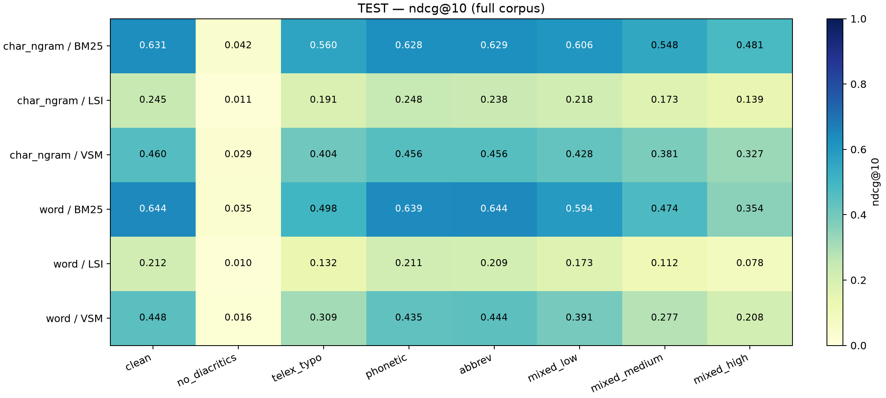

# Kết quả hoàn thành phần Lam — 21/11/2026

Đã hoàn thành pipeline nhiễu/metrics/tích hợp bằng các file mới, dùng lại toàn bộ code term, model và công thức metrics đang có. Không sửa README, TEAM_TASKS, cấu hình, code hoặc dữ liệu đã chốt trước phiên làm việc.

## Phạm vi đã chạy

| Split | Query mỗi lượt | Qrels | Lượt hoàn thành | Tổng đánh giá theo query |
|---|---:|---:|---:|---:|
| Validation seed 42 | 482 | 495 | 48/48 | 23.136 |
| Test giữ nguyên | 788 | 793 | 48/48 | 37.824 |

Mỗi split có hai biểu diễn term × ba model × tám điều kiện query. Mọi lượt truy xuất trên cùng full corpus **61.425 documents**. Vocabulary word **16.498 terms**, char **111.181 n-grams**. Có đầy đủ MRR@10, nDCG@10, Recall@100, suy giảm tuyệt đối/tương đối, ranking và trạng thái của mọi query.

Corpus SHA-256: `dda9c3f0c09627c1a5f2f921384d1c55b6b9775d67ad7254a5bd7a6a119cb9af`.

## Kết quả so sánh

Mean noisy là trung bình nDCG@10 trên **bảy điều kiện nhiễu**, mỗi điều kiện trọng số bằng nhau. Cột clean là nDCG@10 của câu sạch.

| Term | Model | Validation clean | Validation mean noisy | Test clean | Test mean noisy |
|---|---|---:|---:|---:|---:|
| Character n-gram | BM25 | 0,6267 | **0,4915** | 0,6308 | **0,4990** |
| Word | BM25 | **0,6626** | 0,4604 | **0,6444** | 0,4624 |
| Character n-gram | VSM | 0,4833 | 0,3727 | 0,4596 | 0,3542 |
| Word | VSM | 0,5008 | 0,3286 | 0,4484 | 0,2973 |
| Character n-gram | LSI | 0,2637 | 0,1848 | 0,2446 | 0,1740 |
| Word | LSI | 0,2420 | 0,1428 | 0,2122 | 0,1322 |

Theo quy tắc tối đa hóa mean noisy đã ghi trước lượt validation đầu tiên, cấu hình được chọn là **character n-gram + BM25**, `k1=1.2`, `b=0.75`. Cấu hình và index được khóa trong [selection.json](lam_results/val/selection.json) trước khi chạy test. Word + BM25 vẫn có clean tốt hơn; không có kết luận một model thắng mọi điều kiện.

Trên test, cấu hình được chọn có clean **MRR@10 = 0,5675**, **nDCG@10 = 0,6308**, **Recall@100 = 0,9543**. Mixed high đạt nDCG@10 **0,4805**, so với **0,3541** của Word + BM25. Bỏ dấu vẫn rất khó: nDCG@10 chỉ **0,0420** với character n-gram + BM25.

## Bảng, biểu đồ và phân tích

- [Báo cáo validation đủ ba metrics và 48 lượt](lam_results/val/report.md).
- [Báo cáo test đủ ba metrics và 48 lượt](lam_results/test/report.md).
- [CSV validation](lam_results/val/summary.csv), [CSV test](lam_results/test/summary.csv): metrics và drop từng điều kiện.
- [Độ phủ nhiễu validation](lam_results/val/noise_coverage.csv), [độ phủ nhiễu test](lam_results/test/noise_coverage.csv).
- [Mẫu lỗi validation](lam_results/val/worst_queries.csv), [mẫu lỗi test](lam_results/test/worst_queries.csv).
- [Phân tích lỗi và ảnh hưởng của query không đổi](lam_error_analysis.md).
- [Rà soát 70 mẫu cùng năm câu bổ sung theo rủi ro](lam_noise_review.md).
- [Cách chạy lại và sơ đồ file bàn giao](lam_evaluation.md).

Ranking đầy đủ, metrics toàn bộ từng query, paired drops, model đã fit, index và dữ liệu chuẩn hóa nằm trong `outputs/lam/`, được `.gitignore` có sẵn bỏ qua. Snapshot nhỏ để nhóm xem nằm ở [lam_results/](lam_results/README.md).

## Kiểm chứng

- **49/49 unit/integration tests pass**, gồm 37 test cũ và 12 test mới. Có kiểm tra nhiều relevant documents, cutoff, query rỗng/thiếu, status, tie, resume, checksum và render báo cáo.
- **67/67 dataset audit checks pass**; không ghi lại manifest dữ liệu gốc.
- **32/32 điểm nDCG@10 đã báo cáo trước đây khớp** ở bốn chữ số thập phân: [đối chiếu baseline](lam_results/verification/baseline_comparison.csv).
- **Sáu model đã fit trùng SHA-256 giữa validation/test**: [đối chiếu model](lam_results/verification/fitted_model_comparison.json). Không fit từ query hoặc qrels.
- **13/13 file dữ liệu gốc không đổi**, toàn bộ file đã theo dõi trước phiên làm việc không đổi: [kiểm tra tính nguyên vẹn](lam_results/verification/source_integrity.json).
- Biểu đồ validation/test đã được mở kiểm tra trực quan; các snapshot được sao chép từ kết quả được runner kiểm tra checksum.

## Giới hạn khi viết báo cáo

Phonetic/abbreviation có nhiều query không đổi; cần đọc cả điểm toàn tập và điểm trên cùng tập qid thực sự đổi. Mức giảm nhỏ không tự động có nghĩa khả năng chịu nhiễu tốt nếu baseline clean thấp.

Nhiễu tổng hợp có những phép tạo từ khác nghĩa như **lỗi→nỗi**, được ghi rõ trong phần rà soát. Việc đọc mẫu của trợ lý và audit cấu trúc chưa phải xác nhận ngữ nghĩa độc lập của nhóm. Qrels có thể chưa gán nhãn hết tài liệu liên quan. Chưa kiểm định ý nghĩa thống kê của chênh lệch điểm. Test đã từng được xem xét ở giai đoạn trước; không mô tả nó là tập hoàn toàn chưa từng tiếp xúc.

README và báo cáo cũ vẫn giữ trạng thái 32/48 để tôn trọng yêu cầu không sửa phần đã làm. Tài liệu này và các snapshot mới ghi kết quả đầy đủ của lần tích hợp hiện tại.
