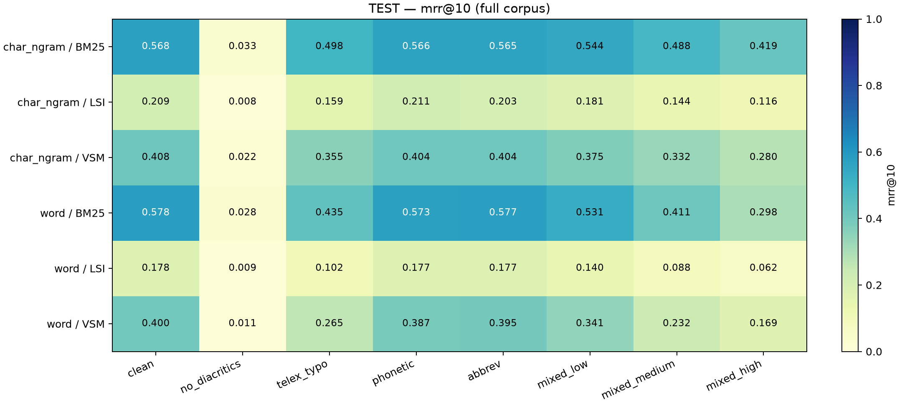
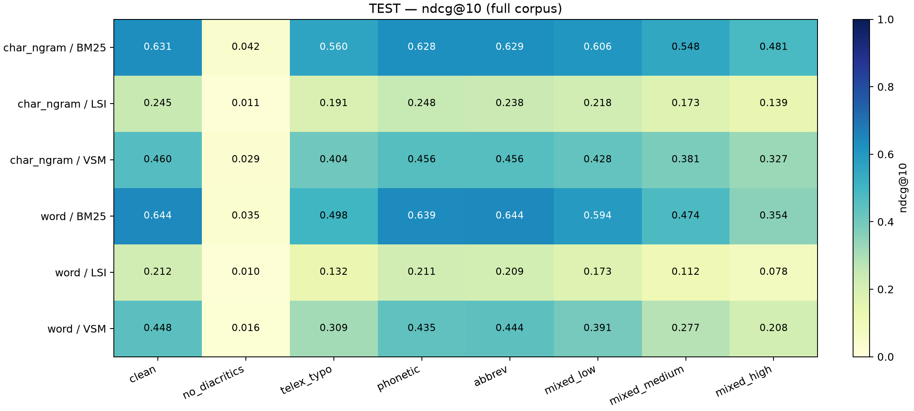
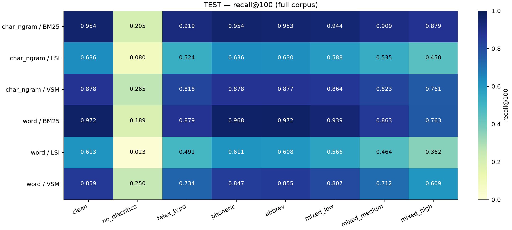
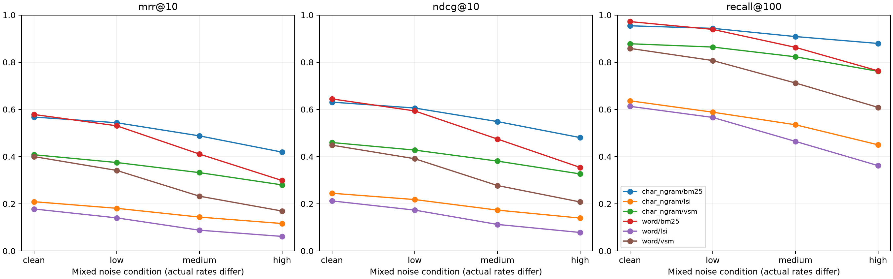

# Kết quả metrics — test

Đủ **48/48 lượt**, **788 queries/lượt**, full corpus; tham số baseline giữ nguyên.

## Chất lượng clean và trung bình bảy điều kiện nhiễu

| Term | Model | Clean MRR@10 | Clean nDCG@10 | Clean Recall@100 | Mean noisy nDCG@10 |
|---|---|---:|---:|---:|---:|
| char_ngram | bm25 | 0.5675 | 0.6308 | 0.9543 | 0.4990 |
| word | bm25 | 0.5784 | 0.6444 | 0.9721 | 0.4624 |
| char_ngram | vsm | 0.4078 | 0.4596 | 0.8782 | 0.3542 |
| word | vsm | 0.3999 | 0.4484 | 0.8585 | 0.2973 |
| char_ngram | lsi | 0.2088 | 0.2446 | 0.6364 | 0.1740 |
| word | lsi | 0.1780 | 0.2122 | 0.6129 | 0.1322 |

## mrr@10

| Điều kiện | char_ngram/bm25 | word/bm25 | char_ngram/vsm | word/vsm | char_ngram/lsi | word/lsi |
|---|---:|---:|---:|---:|---:|---:|
| clean | 0.5675 | 0.5784 | 0.4078 | 0.3999 | 0.2088 | 0.1780 |
| no_diacritics | 0.0326 | 0.0276 | 0.0220 | 0.0111 | 0.0082 | 0.0091 |
| telex_typo | 0.4979 | 0.4347 | 0.3547 | 0.2647 | 0.1589 | 0.1019 |
| phonetic | 0.5655 | 0.5734 | 0.4042 | 0.3873 | 0.2114 | 0.1766 |
| abbrev | 0.5651 | 0.5774 | 0.4037 | 0.3955 | 0.2028 | 0.1766 |
| mixed_low | 0.5435 | 0.5305 | 0.3749 | 0.3414 | 0.1808 | 0.1403 |
| mixed_medium | 0.4878 | 0.4107 | 0.3321 | 0.2322 | 0.1436 | 0.0880 |
| mixed_high | 0.4189 | 0.2985 | 0.2800 | 0.1692 | 0.1163 | 0.0617 |

## ndcg@10

| Điều kiện | char_ngram/bm25 | word/bm25 | char_ngram/vsm | word/vsm | char_ngram/lsi | word/lsi |
|---|---:|---:|---:|---:|---:|---:|
| clean | 0.6308 | 0.6444 | 0.4596 | 0.4484 | 0.2446 | 0.2122 |
| no_diacritics | 0.0420 | 0.0345 | 0.0285 | 0.0158 | 0.0110 | 0.0097 |
| telex_typo | 0.5595 | 0.4976 | 0.4043 | 0.3095 | 0.1912 | 0.1317 |
| phonetic | 0.6281 | 0.6387 | 0.4558 | 0.4352 | 0.2475 | 0.2110 |
| abbrev | 0.6288 | 0.6438 | 0.4558 | 0.4442 | 0.2379 | 0.2094 |
| mixed_low | 0.6058 | 0.5936 | 0.4276 | 0.3910 | 0.2179 | 0.1732 |
| mixed_medium | 0.5485 | 0.4744 | 0.3809 | 0.2774 | 0.1732 | 0.1125 |
| mixed_high | 0.4805 | 0.3541 | 0.3265 | 0.2078 | 0.1394 | 0.0784 |

## recall@100

| Điều kiện | char_ngram/bm25 | word/bm25 | char_ngram/vsm | word/vsm | char_ngram/lsi | word/lsi |
|---|---:|---:|---:|---:|---:|---:|
| clean | 0.9543 | 0.9721 | 0.8782 | 0.8585 | 0.6364 | 0.6129 |
| no_diacritics | 0.2049 | 0.1891 | 0.2652 | 0.2500 | 0.0799 | 0.0228 |
| telex_typo | 0.9188 | 0.8788 | 0.8179 | 0.7335 | 0.5241 | 0.4911 |
| phonetic | 0.9543 | 0.9683 | 0.8782 | 0.8471 | 0.6364 | 0.6110 |
| abbrev | 0.9530 | 0.9721 | 0.8769 | 0.8547 | 0.6301 | 0.6079 |
| mixed_low | 0.9435 | 0.9391 | 0.8642 | 0.8071 | 0.5882 | 0.5660 |
| mixed_medium | 0.9086 | 0.8629 | 0.8230 | 0.7119 | 0.5349 | 0.4645 |
| mixed_high | 0.8794 | 0.7633 | 0.7614 | 0.6085 | 0.4499 | 0.3617 |

## Độ phủ nhiễu thực tế

| Điều kiện | Token thực sự đổi | Query đổi | Query không đổi | Collision mới |
|---|---:|---:|---:|---:|
| no_diacritics | 83.99% | 788 | 0 | 0 |
| telex_typo | 20.15% | 765 | 23 | 0 |
| phonetic | 1.41% | 191 | 597 | 0 |
| abbrev | 1.60% | 215 | 573 | 0 |
| mixed_low | 8.51% | 620 | 168 | 0 |
| mixed_medium | 20.97% | 772 | 16 | 0 |
| mixed_high | 33.92% | 786 | 2 | 0 |

## Diễn giải test

Các cấu hình và tham số đã khóa trước test bằng selection validation. Bảng test phục vụ so sánh sáu baseline, không được dùng chọn lại cấu hình. Tham chiếu selection qua SHA-256 trong manifest.

## Suy giảm và phân tích lỗi

`summary.csv`: điểm toàn tập, drop tuyệt đối/phần trăm và điểm chỉ trên query thực sự đổi. `paired_drops.csv`: ghép sạch–nhiễu theo cùng qid, model, term. Khi điểm clean bằng 0, drop % để trống (N/A). Điểm toàn tập vẫn tính cả query không đổi và query có ranking rỗng.

`worst_queries.csv`: tối đa năm query có nDCG@10 giảm mạnh nhất cho mỗi tổ hợp term/model/noise, kèm văn bản sạch/nhiễu và top 3 document IDs để đối chiếu. Đây là mẫu chọn theo lỗi, không phải mẫu ngẫu nhiên.

## Giới hạn

Nhiễu tổng hợp có thể làm đổi nghĩa; độ phủ phonetic/abbreviation thấp nên điểm toàn tập bị chi phối bởi query không đổi. Cần xem thêm cột changed_only. Qrels có thể chưa liệt kê hết tài liệu liên quan. Không suy ra ý nghĩa thống kê từ chênh lệch điểm nhỏ. Test đã từng được xem xét trong giai đoạn trước.

Rà soát ngữ nghĩa và nhận xét cụ thể được ghi riêng trong tài liệu bàn giao của Lam.
