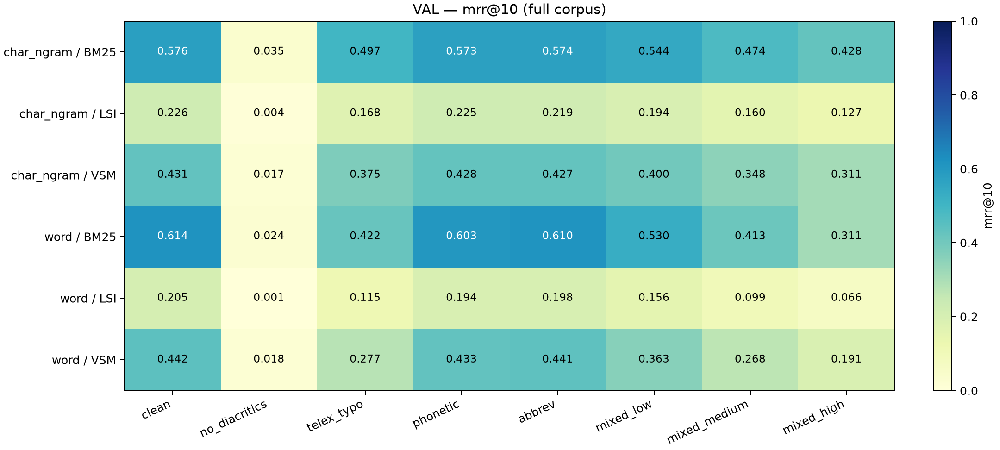
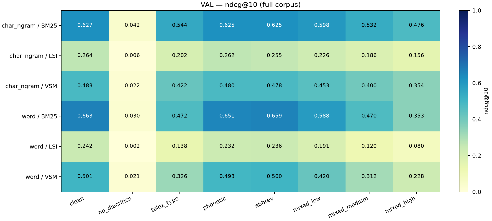
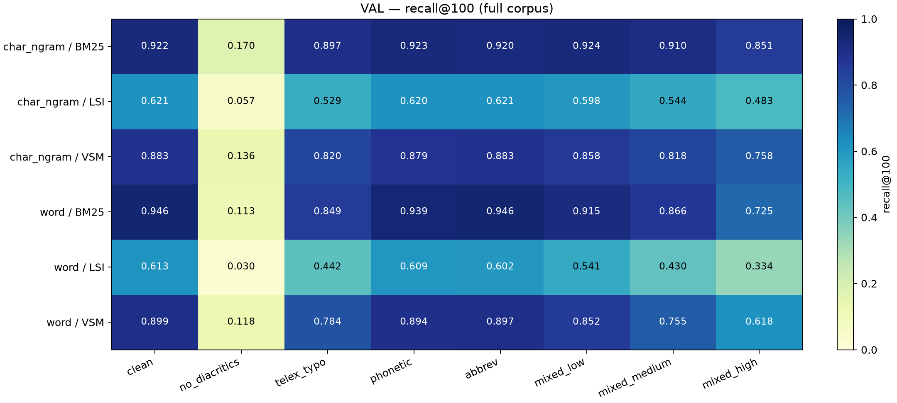
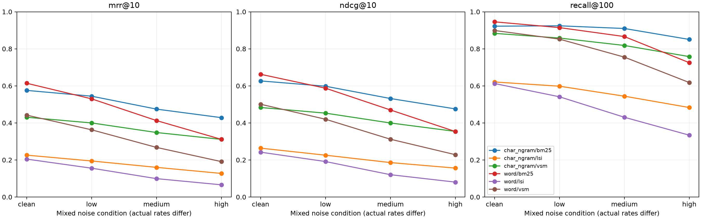

# Kết quả metrics — val

Đủ **48/48 lượt**, **482 queries/lượt**, full corpus; tham số baseline giữ nguyên.

## Chất lượng clean và trung bình bảy điều kiện nhiễu

| Term | Model | Clean MRR@10 | Clean nDCG@10 | Clean Recall@100 | Mean noisy nDCG@10 |
|---|---|---:|---:|---:|---:|
| char_ngram | bm25 | 0.5756 | 0.6267 | 0.9222 | 0.4915 |
| word | bm25 | 0.6143 | 0.6626 | 0.9457 | 0.4604 |
| char_ngram | vsm | 0.4306 | 0.4833 | 0.8835 | 0.3727 |
| word | vsm | 0.4420 | 0.5008 | 0.8990 | 0.3286 |
| char_ngram | lsi | 0.2260 | 0.2637 | 0.6210 | 0.1848 |
| word | lsi | 0.2046 | 0.2420 | 0.6127 | 0.1428 |

## mrr@10

| Điều kiện | char_ngram/bm25 | word/bm25 | char_ngram/vsm | word/vsm | char_ngram/lsi | word/lsi |
|---|---:|---:|---:|---:|---:|---:|
| clean | 0.5756 | 0.6143 | 0.4306 | 0.4420 | 0.2260 | 0.2046 |
| no_diacritics | 0.0350 | 0.0237 | 0.0166 | 0.0177 | 0.0040 | 0.0012 |
| telex_typo | 0.4969 | 0.4215 | 0.3754 | 0.2772 | 0.1681 | 0.1147 |
| phonetic | 0.5734 | 0.6030 | 0.4282 | 0.4334 | 0.2254 | 0.1944 |
| abbrev | 0.5736 | 0.6098 | 0.4273 | 0.4409 | 0.2190 | 0.1979 |
| mixed_low | 0.5443 | 0.5300 | 0.3999 | 0.3628 | 0.1945 | 0.1556 |
| mixed_medium | 0.4745 | 0.4126 | 0.3481 | 0.2677 | 0.1600 | 0.0991 |
| mixed_high | 0.4283 | 0.3110 | 0.3111 | 0.1909 | 0.1272 | 0.0657 |

## ndcg@10

| Điều kiện | char_ngram/bm25 | word/bm25 | char_ngram/vsm | word/vsm | char_ngram/lsi | word/lsi |
|---|---:|---:|---:|---:|---:|---:|
| clean | 0.6267 | 0.6626 | 0.4833 | 0.5008 | 0.2637 | 0.2420 |
| no_diacritics | 0.0423 | 0.0297 | 0.0219 | 0.0209 | 0.0059 | 0.0019 |
| telex_typo | 0.5435 | 0.4725 | 0.4216 | 0.3263 | 0.2023 | 0.1376 |
| phonetic | 0.6250 | 0.6511 | 0.4803 | 0.4925 | 0.2622 | 0.2325 |
| abbrev | 0.6248 | 0.6589 | 0.4785 | 0.5004 | 0.2554 | 0.2358 |
| mixed_low | 0.5980 | 0.5875 | 0.4528 | 0.4198 | 0.2257 | 0.1914 |
| mixed_medium | 0.5317 | 0.4698 | 0.3996 | 0.3119 | 0.1858 | 0.1204 |
| mixed_high | 0.4756 | 0.3534 | 0.3542 | 0.2284 | 0.1560 | 0.0803 |

## recall@100

| Điều kiện | char_ngram/bm25 | word/bm25 | char_ngram/vsm | word/vsm | char_ngram/lsi | word/lsi |
|---|---:|---:|---:|---:|---:|---:|
| clean | 0.9222 | 0.9457 | 0.8835 | 0.8990 | 0.6210 | 0.6127 |
| no_diacritics | 0.1701 | 0.1131 | 0.1359 | 0.1183 | 0.0571 | 0.0301 |
| telex_typo | 0.8973 | 0.8492 | 0.8202 | 0.7839 | 0.5287 | 0.4423 |
| phonetic | 0.9232 | 0.9388 | 0.8793 | 0.8938 | 0.6200 | 0.6086 |
| abbrev | 0.9201 | 0.9457 | 0.8835 | 0.8970 | 0.6210 | 0.6024 |
| mixed_low | 0.9243 | 0.9146 | 0.8582 | 0.8524 | 0.5982 | 0.5411 |
| mixed_medium | 0.9098 | 0.8662 | 0.8181 | 0.7552 | 0.5443 | 0.4305 |
| mixed_high | 0.8506 | 0.7251 | 0.7580 | 0.6179 | 0.4831 | 0.3337 |

## Độ phủ nhiễu thực tế

| Điều kiện | Token thực sự đổi | Query đổi | Query không đổi | Collision mới |
|---|---:|---:|---:|---:|
| no_diacritics | 85.56% | 482 | 0 | 0 |
| telex_typo | 21.18% | 469 | 13 | 0 |
| phonetic | 1.02% | 83 | 399 | 0 |
| abbrev | 1.72% | 137 | 345 | 0 |
| mixed_low | 8.89% | 382 | 100 | 0 |
| mixed_medium | 21.46% | 472 | 10 | 0 |
| mixed_high | 33.33% | 481 | 1 | 0 |

## Chọn cấu hình bằng validation

Quy tắc ghi trước trong manifest: tối đa hóa trung bình nDCG@10 trên bảy điều kiện nhiễu; nếu bằng nhau, ưu tiên clean nDCG@10 rồi thứ tự tên term/model. Không tuning hay sửa model.

Cấu hình được chọn: **char_ngram + bm25**; mean noisy nDCG@10 = **0.4915**. `selection.json` khóa cấu hình trước khi chạy test.

## Suy giảm và phân tích lỗi

`summary.csv`: điểm toàn tập, drop tuyệt đối/phần trăm và điểm chỉ trên query thực sự đổi. `paired_drops.csv`: ghép sạch–nhiễu theo cùng qid, model, term. Khi điểm clean bằng 0, drop % để trống (N/A). Điểm toàn tập vẫn tính cả query không đổi và query có ranking rỗng.

`worst_queries.csv`: tối đa năm query có nDCG@10 giảm mạnh nhất cho mỗi tổ hợp term/model/noise, kèm văn bản sạch/nhiễu và top 3 document IDs để đối chiếu. Đây là mẫu chọn theo lỗi, không phải mẫu ngẫu nhiên.

## Giới hạn

Nhiễu tổng hợp có thể làm đổi nghĩa; độ phủ phonetic/abbreviation thấp nên điểm toàn tập bị chi phối bởi query không đổi. Cần xem thêm cột changed_only. Qrels có thể chưa liệt kê hết tài liệu liên quan. Không suy ra ý nghĩa thống kê từ chênh lệch điểm nhỏ. Test đã từng được xem xét trong giai đoạn trước.

Rà soát ngữ nghĩa và nhận xét cụ thể được ghi riêng trong tài liệu bàn giao của Lam.
